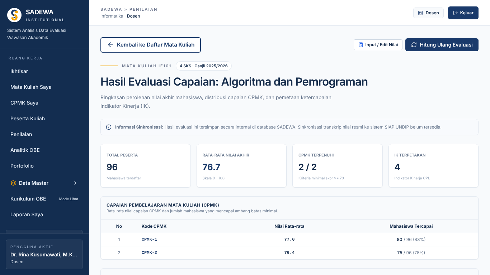
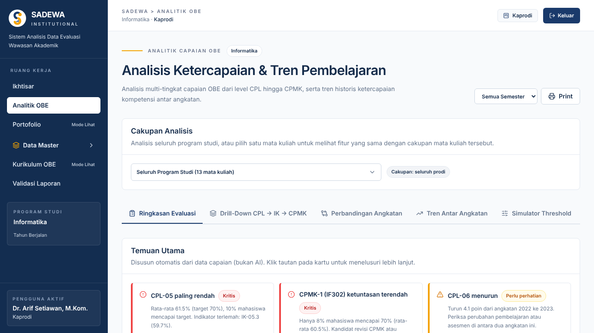
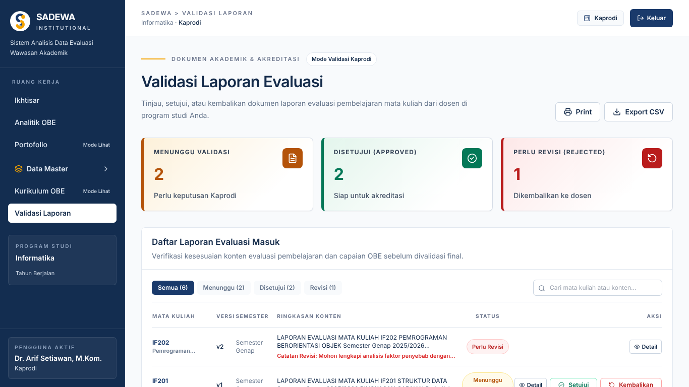
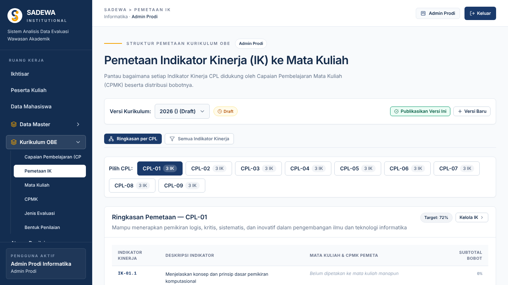

## 2.2 Pengujian Aplikasi

Pengujian aplikasi dilakukan terhadap kode SADEWA versi terakhir yang tersedia di folder proyek tim, yaitu frontend React 18 dengan Vite 5, backend FastAPI dengan PostgreSQL, dan AI Service. Pengujian dijalankan di container cloud, bukan di komputer tim maupun server produksi, sehingga angka waktu yang diperoleh hanya berlaku untuk lingkungan tersebut. Data yang dipakai adalah data sintetis dari skrip `seed_demo`, berisi 5 program studi, 62 mata kuliah, 600 mahasiswa, dan 66.672 baris nilai. Lingkungan, perintah, dan rekap eksekusi setiap kategori uji dirangkum pada Tabel 2.4.

Tabel 2.4. Lingkungan dan Rekap Eksekusi Pengujian

| Kategori Uji | Perintah dan Lingkungan | Hasil | Berkas Log |
|---|---|---|---|
| Tes backend (SQLite) | `python -m pytest` di folder `backend`; SQLite in-memory dari `tests/conftest.py` | 129 lulus, 0 gagal, 2 peringatan (100,29 detik) | `backend-pytest.txt` |
| Tes backend (PostgreSQL) | Salinan suite yang sama dengan koneksi ke PostgreSQL 16.15 | 129 lulus, 0 gagal (128,32 detik) | `backend-pytest-postgresql.txt` |
| Tes AI Service | `python -m pytest` di folder `ai`; LLM tiruan | 53 lulus, 0 gagal (3,13 detik) | `ai-pytest.txt` |
| Tes tambahan | `test_tambahan_c500.py`; SQLite, data `app.core.seed` | 28 lulus, 0 gagal (62,42 detik) | `tambahan-pytest.txt` |
| Kasus acuan kalkulasi | `verifikasi_kasus_acuan.py` | 13 dari 13 nilai cocok | `kalkulasi-kasus-acuan.txt` |
| Lint dan build frontend | `npm ci`, `npm run lint`, `npm run build`; Node 22.23.4 | Lint 0 galat dan 30 peringatan; build berhasil | `frontend-*.txt` |
| Antarmuka | Playwright, Chromium 153 headless, 1366×768 | 5 login dan 21 halaman × 3 ulangan berhasil | `antarmuka/` |
| Waktu respons API | `ukur_waktu_respons.py` (httpx), 30 ulangan per endpoint | 11 endpoint terukur | `kinerja-api.txt` |
| Keamanan server hidup | Permintaan HTTP ke backend :8000 dan Playwright | 11 skenario tercatat | `keamanan-*.txt` |
| Keluaran LLM asli | `uji_keluaran_ai.py` | Belum dijalankan | – |

Tabel 2.4 menunjukkan bahwa 210 tes otomatis yang dijalankan pada lingkungan uji seluruhnya lulus, dengan rincian 129 tes backend, 53 tes AI Service, dan 28 tes tambahan. Suite backend dijalankan dua kali, yaitu pada SQLite in-memory bawaan repositori dan pada PostgreSQL 16.15 dengan salinan tes yang hanya diubah koneksi basis datanya. Lint frontend tidak menemukan galat, tetapi menghasilkan 30 peringatan `react-hooks/exhaustive-deps`. Build frontend berhasil dengan peringatan ukuran berkas JavaScript sebesar 1.289,49 kB sebelum kompresi.

### 2.2.1 Pengujian Fungsional Sistem dengan *Black Box Testing*

Metode black-box menguji perangkat lunak dari sisi masukan dan keluaran tanpa memperhatikan struktur kode di dalamnya [3]. Pada SADEWA, metode ini diterapkan pada endpoint REST API melalui tes otomatis pytest dengan TestClient FastAPI, dan pada antarmuka web melalui Playwright pada Chromium. Untuk masukan bernilai rentang, kasus uji dibagi menjadi kelas masukan yang sah dan tidak sah sesuai teknik equivalence partitioning, misalnya nilai mahasiswa di bawah 0, antara 0 dan 100, serta di atas 100. Kolom Bentuk Pengujian pada setiap tabel menyebut berkas tes atau skrip yang menjadi bukti, dan seluruh berkas log tersimpan di folder `bukti-uji`. Hasil ditulis Berhasil jika keluaran sesuai dengan hasil yang diharapkan, Gagal jika tidak sesuai, Sebagian jika hanya sebagian kebutuhan yang terpenuhi, dan Belum diuji jika pengujian tidak dapat dijalankan pada lingkungan uji.

#### A. Pengujian Autentikasi

Pengujian autentikasi mencakup login, profil akun, pendaftaran akun pertama, keabsahan token, dan logout untuk kelima peran SADEWA. Pengujian API dijalankan dengan pytest pada SQLite in-memory menggunakan data dari `app.core.seed`, sedangkan pengujian antarmuka dan pengujian pada server hidup dijalankan terhadap backend yang terhubung ke PostgreSQL, dengan hasil seperti tercantum pada Tabel 2.5.

Tabel 2.5. Pengujian Fitur Autentikasi

| SRS-id | Kode Pengujian | Nama Pengujian | Bentuk Pengujian | Hasil yang Diharapkan | Hasil Pengujian |
|---|---|---|---|---|---|
| SADEWA-01 | A101 | Login dengan akun setiap peran. | Login melalui API dan halaman `/login` dengan akun Super Admin, Admin Prodi, Kaprodi, Dosen, dan Dekan (`test_auth.py`, T01, Playwright). | Token JWT memuat identitas, peran, dan waktu kedaluwarsa; antarmuka membuka halaman awal sesuai peran. | Berhasil (5 dari 5 peran) |
| SADEWA-01 | A102 | Login dengan kata sandi salah. | Email terdaftar dengan kata sandi yang salah (`test_auth.py`). | Login ditolak dengan status 401. | Berhasil |
| SADEWA-01 | A103 | Login dengan email tidak terdaftar. | Email `tidakada@sadewa.ac.id` (T02). | Login ditolak dengan status 401. | Berhasil |
| SADEWA-01 | A104 | Login dengan pola SQL injection. | Email dan kata sandi diisi `' OR '1'='1` (T03 dan uji server hidup K5). | Permintaan ditolak tanpa galat server (status 401 atau 422). | Berhasil (status 422, format email ditolak) |
| SADEWA-01 | A105 | Melihat profil akun yang sedang masuk. | GET `/auth/me` dengan token sah (`test_auth.py`, T04). | Profil dikembalikan tanpa kata sandi maupun hash kata sandi. | Berhasil |
| SADEWA-01 | A106 | Pendaftaran akun pertama. | POST `/auth/register` pada basis data kosong, lalu diulang setelah ada pengguna (`test_auth.py`). | Akun pertama dibuat sebagai Super Admin, pendaftaran berikutnya ditolak. | Berhasil |
| SADEWA-01 | A107 | Akses dengan token kedaluwarsa. | Token dibuat dengan masa berlaku negatif lalu dipakai ke `/auth/me` (T06). | Akses ditolak dengan status 401. | Berhasil |
| SADEWA-01 | A108 | Akses dengan token palsu atau rusak. | Token ditandatangani kunci lain (T07) dan token dengan isi acak (uji server hidup K2). | Akses ditolak dengan status 401. | Berhasil |
| SADEWA-01 | A109 | Akses oleh akun yang dinonaktifkan. | Akun Dosen dinonaktifkan setelah login, lalu token lamanya dipakai (T08). | Akses ditolak dengan status 401. | Berhasil |
| SADEWA-01 | A110 | Keluar dari sistem (logout). | Login sebagai Dosen di Chromium, menekan tombol Keluar, lalu membuka `/dashboard` (Playwright). | Token terhapus dari penyimpanan peramban, halaman kembali ke `/login`, dan `/dashboard` tanpa sesi dialihkan ke `/login`. | Berhasil |

Berdasarkan Tabel 2.5, seluruh 10 kasus uji autentikasi memberikan hasil sesuai dengan yang diharapkan. Login lewat antarmuka untuk kelima peran membutuhkan 1.066 sampai 1.142 ms hingga pengguna diarahkan ke halaman awalnya. Pola SQL injection pada isian email ditolak oleh validator format email dengan status 422 sebelum mencapai basis data. Logout pada antarmuka menghapus token dari penyimpanan peramban, tetapi token yang sudah disalin sebelumnya masih diterima server; hal ini dibahas pada pengujian security.

#### B. Pengujian Fitur

Pengujian fitur dikelompokkan menurut kebutuhan fungsional SADEWA, mulai dari pembatasan hak akses, pengelolaan akun dan kurikulum, nilai, kalkulasi, analitik, dokumen AI, hingga knowledge base.

**a. Pembatasan Hak Akses dan Cakupan Data**

Pengujian ini memeriksa pembatasan hak akses berbasis peran dan cakupan data per program studi, fakultas, serta dosen pengampu. Skenario disusun dengan mencoba setiap operasi menggunakan peran yang tidak berwenang atau data milik prodi lain, menggunakan tes otomatis dan permintaan HTTP langsung ke server hidup, lalu hasilnya dirangkum pada Tabel 2.6.

Tabel 2.6. Pengujian Pembatasan Hak Akses dan Cakupan Data

| SRS-id | Kode Pengujian | Nama Pengujian | Bentuk Pengujian | Hasil yang Diharapkan | Hasil Pengujian |
|---|---|---|---|---|---|
| SADEWA-NF-02 | B101 | Akses endpoint data akademik tanpa token. | GET `/mata-kuliah`, `/kalkulasi/{id}`, `/analitik/prodi`, dan `/users` tanpa header Authorization (`test_auth.py`, T09, K1). | Seluruh permintaan ditolak dengan status 401. | Berhasil |
| SADEWA-01 | B102 | Dosen membuat akun pengguna. | POST `/users` dengan token Dosen (T10). | Ditolak dengan status 403. | Berhasil |
| SADEWA-01 | B103 | Dekan membuat data CPL. | POST `/cpl` dengan token Dekan (T11). | Ditolak dengan status 403 karena Dekan hanya dapat melihat. | Berhasil |
| SADEWA-01 | B104 | Dekan membaca analitik prodi di fakultasnya. | GET `/analitik/prodi` untuk prodi di fakultas Dekan (T12, `test_analitik.py`). | Data analitik dikembalikan dengan status 200. | Berhasil |
| SADEWA-01 | B105 | Admin Prodi membuka mata kuliah prodi lain. | GET `/mata-kuliah/{id}` milik prodi lain (T13 dan uji server hidup K3). | Ditolak dengan status 403 atau 404. | Berhasil (status 403) |
| SADEWA-01 | B106 | Dosen bukan pengampu menjalankan kalkulasi. | POST `/kalkulasi/run/{id}` oleh dosen prodi lain (T14, K4, `test_master_evaluasi.py`). | Ditolak dengan status 403. | Berhasil |
| SADEWA-01 | B107 | Super Admin membuka data akademik. | Super Admin mengakses data mata kuliah dan nilai (`test_users.py`). | Ditolak karena Super Admin hanya mengelola fakultas, prodi, dan akun. | Berhasil |
| SADEWA-01 | B108 | Admin Prodi membuka dasbor dosen dan tren angkatan. | GET `/dashboard/{id}` dan `/trending` dengan token Admin Prodi (`test_ui_audit_fixes.py`). | Ditolak dengan status 403. | Berhasil |
| SADEWA-01 | B109 | Dosen melihat daftar mata kuliah dan rapor. | Dosen membuka daftar mata kuliah, `/mata-kuliah/saya`, dan rapor (`test_ui_audit_fixes.py`). | Hanya mata kuliah yang diampu yang ditampilkan. | Berhasil |
| SADEWA-01 | B110 | Admin Prodi mengubah CPMK prodi lain. | Admin Prodi mengubah CPMK melalui ID milik prodi lain (`test_akses_cpmk.py`). | Ditolak karena data di luar cakupan prodi. | Berhasil |
| SADEWA-01 | B111 | Dosen bukan pengampu mengubah CPMK. | Dosen yang tidak mengampu mencoba ubah, petakan, dan hapus CPMK (`test_akses_cpmk.py`). | Seluruh operasi ditolak. | Berhasil |
| SADEWA-01 | B112 | Akses arsip kurikulum per peran. | Setiap peran membuka arsip kurikulum (`test_arsip.py`). | Arsip hanya dapat dibuka peran yang berwenang sesuai cakupannya. | Berhasil |

Pada Tabel 2.6, keseluruhan 12 kasus uji memberikan hasil sesuai harapan, baik untuk pembatasan berdasarkan peran maupun pembatasan berdasarkan prodi dan dosen pengampu. Permintaan ke data prodi lain ditolak dengan status 403 beserta pesan penolakan, bukan dengan data kosong, sehingga pengguna dapat mengetahui alasan penolakannya.

**b. Pengelolaan Akun Pengguna**

Pengujian pengelolaan akun mencakup operasi tambah, ubah, dan hapus akun oleh Super Admin dan Admin Prodi. Tiga kasus terakhir pada Tabel 2.7 ditulis sebagai tes tambahan karena operasi ubah dan hapus akun belum memiliki tes pada repositori.

Tabel 2.7. Pengujian Pengelolaan Akun Pengguna

| SRS-id | Kode Pengujian | Nama Pengujian | Bentuk Pengujian | Hasil yang Diharapkan | Hasil Pengujian |
|---|---|---|---|---|---|
| SADEWA-10 | C101 | Super Admin membuat akun Admin Prodi. | POST `/users` dengan peran Admin Prodi dan program studi (`test_users.py`). | Akun terbentuk dan terikat ke program studi. | Berhasil |
| SADEWA-10 | C102 | Membuat akun Admin Prodi tanpa program studi. | POST `/users` tanpa `program_studi_id` (`test_users.py`). | Permintaan ditolak. | Berhasil |
| SADEWA-10 | C103 | Admin Prodi membuat akun dengan peran tertentu. | Admin Prodi membuat akun Dosen, Kaprodi, dan peran lain (`test_users.py`). | Hanya akun Dosen dan Kaprodi yang diterima. | Berhasil |
| SADEWA-10 | C104 | Admin Prodi melihat daftar akun. | GET `/users` oleh Admin Prodi (`test_users.py`). | Akun di luar prodinya tidak ditampilkan. | Berhasil |
| SADEWA-10 | C105 | Mengubah data akun. | PUT `/users/{id}` untuk mengganti nama akun Dosen di prodi yang sama (T22). | Data tersimpan dan nama baru dikembalikan. | Berhasil |
| SADEWA-10 | C106 | Menghapus akun. | DELETE `/users/{id}` untuk akun Dosen, lalu akun tersebut mencoba login (T23). | Akun dinonaktifkan dan login berikutnya ditolak. | Berhasil (akun dinonaktifkan, tidak dihapus permanen) |
| SADEWA-10 | C107 | Mengubah dan menghapus akun prodi lain. | PUT dan DELETE `/users/{id}` oleh Admin Prodi terhadap akun Dosen prodi lain (T24). | Kedua operasi ditolak dengan status 403. | Berhasil |

Berdasarkan Tabel 2.7, seluruh 7 kasus uji pengelolaan akun memberikan hasil sesuai harapan, termasuk penolakan terhadap perubahan akun milik prodi lain. Operasi hapus akun pada SADEWA dilaksanakan sebagai penonaktifan, sehingga data akun tetap tersimpan dan riwayat nilai yang terkait dengan akun tersebut tidak ikut terhapus.

**c. Pengelolaan Kurikulum OBE**

Pengujian kurikulum OBE memeriksa pengelolaan versi kurikulum, CPL, IK, CPMK, pemetaan, bobot, bentuk penilaian, dan aturan penilaian prodi. Selain operasi tambah dan ubah, pengujian ini juga mencoba memasukkan konfigurasi yang tidak konsisten agar terlihat apakah sistem menolaknya, dan hasilnya disajikan pada Tabel 2.8.

Tabel 2.8. Pengujian Pengelolaan Kurikulum OBE

| SRS-id | Kode Pengujian | Nama Pengujian | Bentuk Pengujian | Hasil yang Diharapkan | Hasil Pengujian |
|---|---|---|---|---|---|
| SADEWA-11 | D101 | Membuat fakultas dan program studi. | Super Admin membuat fakultas dan prodi, lalu Dosen mencoba membuat prodi (`test_users.py`). | Data dibuat oleh Super Admin; permintaan Dosen ditolak. | Berhasil |
| SADEWA-11 | D102 | Membuat versi kurikulum. | POST `/kurikulum/versions` dengan versi, deskripsi, dan tahun (`test_ui_audit_fixes.py`). | Versi tersimpan dengan status draft. | Berhasil |
| SADEWA-11 | D103 | Total bobot IK terhadap bobot CPMK. | Bobot IK pada pemetaan dibuat kurang atau lebih dari bobot CPMK, lalu bobot CPMK diubah (`test_validasi_obe.py`). | Pemetaan dengan total berbeda ditolak dan divalidasi ulang saat bobot berubah. | Berhasil |
| SADEWA-11 | D104 | Pemetaan IK yang tidak sah. | Memetakan IK milik prodi lain dan membuat IK tanpa CPL (`test_validasi_obe.py`). | Kedua permintaan ditolak. | Berhasil |
| SADEWA-11 | D105 | Mengatur bobot dan pemetaan CPMK. | Dosen pengampu, Admin Prodi, dan Kaprodi mengubah nama, bobot, dan pemetaan IK pada CPMK (`test_akses_cpmk.py`). | Perubahan diterima untuk peran yang berwenang. | Berhasil |
| SADEWA-11 | D106 | Mengatur bobot jenis evaluasi. | Bobot −5 dan 110 dikirim oleh Admin Prodi, lalu Dosen mencoba menyimpan bobot (`test_jenis_evaluasi_bobot.py`). | Bobot di luar 0–100 dan permintaan Dosen ditolak; total bobot ikut diperiksa saat cek siap dinilai. | Berhasil |
| SADEWA-11 | D107 | Mengelola bentuk penilaian. | Tambah, ubah, dan hapus bentuk penilaian (`test_master_evaluasi.py`). | Operasi berjalan dan data tersimpan. | Berhasil |
| SADEWA-11 | D108 | Menghapus data kurikulum yang masih berelasi. | Menghapus CPL yang punya IK, IK yang terpetakan, CPMK yang punya nilai, serta jenis evaluasi, mata kuliah, dan bentuk penilaian yang masih dipakai (`test_hapus_obe.py`, `test_cpmk_hapus.py`, `test_ui_audit_fixes.py`). | Penghapusan ditolak dengan status 409; data tanpa relasi dapat dihapus. | Berhasil |
| SADEWA-11 | D109 | Mencegah data ganda. | NIM, kode mata kuliah, dan nama jenis evaluasi yang sudah ada dikirim ulang (`test_ui_audit_fixes.py`). | Ditolak dengan status 400. | Berhasil |
| SADEWA-11 | D110 | Mengatur skala nilai huruf dan rentang kategori CPL. | Menyimpan skala huruf dan rentang nilai CPL, termasuk rentang yang tumpang tindih (`test_skala_nilai.py`, `test_range_nilai.py`). | Skala yang sah tersimpan; rentang tidak sah ditolak. | Berhasil |
| SADEWA-11 | D111 | Mengatur aturan penilaian prodi. | Menyimpan aturan bawaan, ambang ketercapaian, dan skala per angkatan (`test_aturan_skala_info.py`). | Aturan tersimpan sesuai hak akses dan dipakai pada kalkulasi. | Berhasil |
| SADEWA-11 | D112 | Menetapkan koordinator mata kuliah. | Menetapkan dosen kedua sebagai koordinator (`test_ui_audit_fixes.py`). | Hanya ada satu koordinator per mata kuliah. | Berhasil |

Pada Tabel 2.8, seluruh 12 kasus uji memberikan hasil sesuai harapan, termasuk penolakan terhadap total bobot yang tidak konsisten dan pemetaan lintas prodi. Penghapusan data yang masih dipakai ditolak dengan status 409, sehingga CPL, IK, atau CPMK yang sudah memiliki nilai tidak hilang dan tidak meninggalkan data yatim pada tabel relasi.

**d. Pengelolaan Nilai**

Pengujian nilai mencakup input nilai manual per IK, syarat sebuah mata kuliah siap dinilai, pengelolaan peserta, finalisasi, dan sinkronisasi dengan SIAP UNDIP. Untuk input nilai, masukan dibagi menjadi tiga kelas, yaitu di bawah 0, antara 0 dan 100, serta di atas 100, dan hasil seluruh skenario disajikan pada Tabel 2.9.

Tabel 2.9. Pengujian Pengelolaan Nilai

| SRS-id | Kode Pengujian | Nama Pengujian | Bentuk Pengujian | Hasil yang Diharapkan | Hasil Pengujian |
|---|---|---|---|---|---|
| SADEWA-02 | E101 | Input nilai manual per IK. | POST `/nilai/manual` dengan nilai 0–100 pada sel matriks yang sah (`test_nilai_per_ik.py`). | Nilai tersimpan. | Berhasil |
| SADEWA-02 | E102 | Input nilai di luar rentang. | Nilai −10 dan 105 dikirim pada sel yang sah (`test_nilai_per_ik.py`). | Kedua nilai ditolak dengan status 400 atau 422. | Berhasil |
| SADEWA-02 | E103 | Input nilai ganda dan sel tidak sah. | Mengirim kombinasi peserta, bentuk penilaian, dan IK yang sama dua kali, serta nilai pada sel berbobot nol (`test_nilai_per_ik.py`). | Kedua permintaan ditolak. | Berhasil |
| SADEWA-02 | E104 | Syarat siap dinilai. | Enam kondisi dibuat tidak terpenuhi satu per satu, misalnya total bobot CPMK bukan 100 dan CPMK tanpa pemetaan IK (`test_siap_nilai_terpisah.py`, `test_validasi_obe.py`). | Input nilai ditolak selama ada syarat yang belum terpenuhi; konfigurasi lengkap diterima. | Berhasil |
| SADEWA-02 | E105 | Mengelola mahasiswa dan peserta kelas. | Tambah peserta, impor banyak mahasiswa dan peserta sekaligus, turunan angkatan dari NIM, dan status akademik (`test_master_evaluasi.py`, `test_ui_audit_fixes.py`, `test_mahasiswa_status_akademik.py`). | Data tersimpan, angkatan terisi otomatis, dan status tidak sah ditolak. | Berhasil |
| SADEWA-02 | E106 | Finalisasi dan koreksi nilai. | Finalisasi peserta, penolakan bila syarat belum terpenuhi, buka kunci, lalu koreksi nilai (`test_finalisasi_obe.py`). | Nilai terkunci setelah finalisasi dan hanya dapat dikoreksi setelah kunci dibuka. | Berhasil |
| SADEWA-02 | E107 | Sinkronisasi nilai dari SIAP UNDIP. | POST `/nilai/sync` oleh dosen pengampu (T16) dan pengamatan halaman Hasil Evaluasi Capaian. | Data nilai ditarik dari SIAP UNDIP ke basis data SADEWA. | Gagal (respons `not_configured`; belum ada koneksi ke SIAP, permintaan hanya dicatat di `siap_sync_logs`) |

Berdasarkan Tabel 2.9, 6 dari 7 kasus uji berhasil, sedangkan satu kasus yang gagal adalah sinkronisasi nilai dari SIAP UNDIP. Endpoint `/nilai/sync` sudah ada, tetapi hanya mengembalikan status `not_configured` dan mencatat permintaan ke tabel `siap_sync_logs` tanpa menarik data. Halaman Hasil Evaluasi Capaian juga menampilkan informasi bahwa sinkronisasi ke SIAP UNDIP belum tersedia. Dengan demikian, kebutuhan input nilai saat ini baru terpenuhi melalui jalur manual, yang pada rancangan hanya diposisikan sebagai cadangan. [ISI: rencana tim terkait akses API SIAP UNDIP, jika sudah ada]

**e. Kalkulasi Ketercapaian**

Pengujian kalkulasi pada bagian ini melengkapi subbab 2.1.1 dari sisi endpoint dan antarmuka, yaitu menjalankan kalkulasi, menguji kasus batas, menggabungkan capaian lintas mata kuliah, menentukan nilai huruf, dan menampilkan hasil di peramban. Hasil pengujian tersebut disajikan pada Tabel 2.10.

Tabel 2.10. Pengujian Kalkulasi Ketercapaian

| SRS-id | Kode Pengujian | Nama Pengujian | Bentuk Pengujian | Hasil yang Diharapkan | Hasil Pengujian |
|---|---|---|---|---|---|
| SADEWA-03 | F101 | Menjalankan kalkulasi dan membaca hasil. | POST `/kalkulasi/run/{id}` lalu GET `/kalkulasi/{id}` oleh dosen pengampu (T15). | Kalkulasi selesai dan hasil dapat dibaca. | Berhasil |
| SADEWA-03 | F102 | Pembulatan poin per sel dan nilai akhir. | Poin sel 13,5 × 75 / 100 dan pembulatan nilai akhir yang terpisah dari poin CPL (`test_obe_formula.py`). | Poin sel 10,13 dan nilai akhir dibulatkan setelah seluruh poin dijumlahkan. | Berhasil |
| SADEWA-03 | F103 | Perhitungan Kasus Acuan 1. | Masukan Kasus Acuan 1 dihitung oleh `compute_result` (`test_obe_formula.py` dan `verifikasi_kasus_acuan.py`). | Poin dan persen enam CPL serta nilai akhir sama dengan nilai harapan. | Berhasil (selisih 0,00 pada 13 nilai) |
| SADEWA-03 | F104 | Kasus batas kalkulasi. | Nilai kosong, satu CPMK dengan beberapa CPL, bobot_CP nol, bobot bentuk penilaian nol, dan masukan kosong (`test_obe_formula.py`, `test_ik_contribution.py`). | Kalkulasi tetap berjalan tanpa pembagian dengan nol. | Berhasil |
| SADEWA-03 | F105 | Persentase IK dan CPMK. | Membandingkan persen IK dan CPMK hasil sistem dengan hitungan rumus (`test_analitik.py`). | Persen sesuai Persamaan (2.4) dan berada pada rentang 0–100. | Berhasil |
| SADEWA-03 | F106 | Gabungan capaian CPL lintas mata kuliah. | Capaian CPL dari beberapa mata kuliah digabung dengan bobot_CP (`test_cpl_aggregate.py`). | Rata-rata berbobot terbentuk per mahasiswa; bobot nol diabaikan. | Berhasil |
| SADEWA-03 | F107 | Penentuan nilai huruf dan ambang prodi. | Pemilihan huruf dari skala, dua kurikulum dengan skala berbeda, perubahan skala setelah finalisasi, dan ambang prodi (`test_skala_nilai.py`, `test_range_nilai.py`, `test_aturan_skala_info.py`). | Huruf sesuai skala yang berlaku; nilai final tidak berubah saat skala diedit. | Berhasil |
| SADEWA-03 | F108 | Alur OBE dari data awal sampai kalkulasi. | Integrasi data kurikulum, nilai, dan mahasiswa tanpa nilai, serta data contoh yang langsung siap dinilai (`test_integrasi_obe.py`, `test_ui_audit_fixes.py`). | Capaian terbentuk untuk mahasiswa bernilai dan tidak menimbulkan galat untuk mahasiswa tanpa nilai. | Berhasil |
| SADEWA-03 | F109 | Menampilkan hasil kalkulasi di antarmuka. | Membuka `/penilaian/1/hasil` sebagai Dosen di Chromium (Playwright). | Halaman Hasil Evaluasi Capaian tampil dengan ringkasan CPMK dan IK. | Berhasil |

Pada Tabel 2.10, seluruh 9 kasus uji memberikan hasil sesuai harapan, termasuk kasus batas yang berpotensi menimbulkan pembagian dengan nol. Tampilan halaman Hasil Evaluasi Capaian untuk mata kuliah dengan 96 peserta ditunjukkan pada Gambar 2.1.

Gambar 2.1. Halaman Hasil Evaluasi Capaian pada akun Dosen (Chromium headless, 1366×768)

**f. Analitik dan Dasbor**

Pengujian analitik memeriksa perhitungan kontribusi komponen penilaian terhadap IK serta tampilan dasbor dan analitik untuk setiap peran. Kontribusi komponen inilah yang dipakai untuk menelusuri komponen tugas yang menurunkan capaian IK, CPMK, dan CPL, dan hasil pengujiannya disajikan pada Tabel 2.11.

Tabel 2.11. Pengujian Analitik dan Dasbor

| SRS-id | Kode Pengujian | Nama Pengujian | Bentuk Pengujian | Hasil yang Diharapkan | Hasil Pengujian |
|---|---|---|---|---|---|
| SADEWA-04 | G101 | Kontribusi bentuk penilaian terhadap IK. | Satu dan beberapa bentuk penilaian dengan bobot penuh, sebagian, dan tanpa pemetaan IK (`test_ik_contribution.py`). | Kontribusi tiap komponen terhadap IK dihitung sesuai bobotnya. | Berhasil |
| SADEWA-05 | G102 | Analitik mata kuliah untuk Dosen. | GET `/analitik/mata-kuliah/{id}` oleh dosen pengampu (`test_analitik.py`). | Data capaian CPL, CPMK, dan IK mata kuliah dikembalikan. | Berhasil |
| SADEWA-05 | G103 | Dasbor dan analitik pada antarmuka. | Membuka `/dashboard` dan `/analisis` sebagai Dosen, Kaprodi, dan Dekan di Chromium (Playwright). | Halaman tampil dengan judul sesuai peran tanpa galat aplikasi di konsol. | Berhasil (6 halaman) |
| SADEWA-05 | G104 | Analitik tingkat universitas. | Menelusuri rute yang tersedia untuk kelima peran pada pengujian antarmuka. | Tersedia tampilan ketercapaian pada tingkat universitas. | Gagal (rute tertinggi adalah tingkat fakultas untuk Dekan; tidak ada tampilan tingkat universitas) |

Berdasarkan Tabel 2.11, 3 dari 4 kasus uji berhasil dan satu kasus gagal karena tampilan tingkat universitas belum tersedia. Dasbor tersedia pada tingkat kelas untuk Dosen, tingkat program studi untuk Kaprodi, dan tingkat fakultas untuk Dekan, seperti contoh pada Gambar 2.2. Pada versi yang diuji, tidak ada peran maupun rute untuk tingkat universitas, sehingga kebutuhan pemantauan pada tingkat tersebut belum terpenuhi.

Gambar 2.2. Halaman Analitik OBE pada akun Kaprodi (Chromium headless, 1366×768)

**g. Dokumen AI dan Laporan Evaluasi**

Pengujian dokumen AI dan laporan evaluasi dilakukan pada sisi backend, dengan AI Service digantikan tiruan pada tes otomatis. Pada server hidup, AI Service sengaja tidak dijalankan untuk melihat cara backend menangani kegagalannya. Alur laporan diuji dari pembuatan, pengajuan, hingga persetujuan atau pengembalian oleh Kaprodi, dan hasil seluruh skenario disajikan pada Tabel 2.12.

Tabel 2.12. Pengujian Dokumen AI dan Laporan Evaluasi

| SRS-id | Kode Pengujian | Nama Pengujian | Bentuk Pengujian | Hasil yang Diharapkan | Hasil Pengujian |
|---|---|---|---|---|---|
| SADEWA-07 | H101 | Generate draf RPS dari backend. | Permintaan generate RPS biasa dan streaming dengan AI Service tiruan (`test_ai_integration.py`, `test_ai_stream.py`). | Progres diteruskan ke klien dan draf tersimpan di tabel RPS. | Berhasil (AI tiruan) |
| SADEWA-07 | H102 | Generate RPS saat AI Service tidak aktif. | POST `/rps/{id}/generate` saat port 8001 mati (K6) serta simulasi koneksi gagal dan timeout (`test_ai_integration.py`, `test_ai_stream.py`). | Backend membalas 503 atau 504 dengan pesan yang jelas dan fitur lain tetap berjalan. | Berhasil (status 503) |
| SADEWA-07 | H103 | Mengubah dan menghapus draf RPS. | Dosen pengampu dan dosen lain mengubah serta menghapus RPS (`test_rps_crud.py`, `test_ai_stream.py`). | Hanya dosen pengampu yang dapat mengubah dan menghapus. | Berhasil |
| SADEWA-06 | H104 | Meminta narasi sebelum ada kalkulasi. | Permintaan narasi untuk mata kuliah tanpa hasil kalkulasi (`test_ai_integration.py`, `test_ai_stream.py`). | Ditolak dengan status 422 sebelum LLM dipanggil. | Berhasil |
| SADEWA-06 | H105 | Generate narasi dari data capaian. | Narasi streaming dengan AI Service tiruan (`test_ai_stream.py`, `test_rps_crud.py`). | Angka capaian hasil kalkulasi dikirim ke AI Service dan narasi tersimpan pada laporan. | Berhasil (AI tiruan) |
| SADEWA-06, SADEWA-07 | H106 | Generate RPS dan narasi dengan Qwen. | Menjalankan `uji_keluaran_ai.py` pada AI Service dengan LLM asli. | Draf lolos validator, waktu generate sesuai target, dan status narasi cocok dengan data. | Belum diuji [ISI: hasil `uji_keluaran_ai.py` dari mesin tim] |
| SADEWA-09 | H107 | Mengajukan laporan dan persetujuan Kaprodi. | Dosen membuat dan mengajukan laporan, lalu Kaprodi menyetujui (T17). | Status berubah menjadi approved dan validator tercatat. | Berhasil |
| SADEWA-09 | H108 | Laporan dikembalikan dan direvisi. | Kaprodi menolak dengan catatan, lalu Dosen mengubah isi laporan (T18). | Status menjadi rejected, lalu kembali ke draft setelah direvisi. | Berhasil |
| SADEWA-09 | H109 | Validasi oleh peran yang tidak berwenang. | Admin Prodi dan Kaprodi prodi lain menyetujui laporan (T19, T20). | Keduanya ditolak dengan status 403. | Berhasil |
| SADEWA-09 | H110 | Mengajukan laporan tanpa isi. | Laporan kosong diajukan (T21). | Ditolak dengan status 400. | Berhasil |
| SADEWA-09 | H111 | Ekspor portofolio mata kuliah. | GET `/portofolio/{id}/export` untuk mata kuliah berisi data dan kosong, serta oleh peran yang tidak berwenang (`test_portofolio_export.py`). | Berkas Excel memuat semua sheet dan rumus, nilainya sama dengan hasil kalkulasi, dan akses dibatasi. | Berhasil |
| SADEWA-09 | H112 | Mengunduh laporan evaluasi tingkat program studi. | Mengunduh laporan evaluasi kurikulum prodi dari antarmuka. | Berkas terstruktur untuk bahan borang akreditasi terunduh. | Belum diuji [ISI: hasil unduh laporan evaluasi dari halaman Validasi Laporan, beserta format berkasnya] |
| SADEWA-09 | H113 | Menampilkan halaman Validasi Laporan. | Membuka `/dokumen` sebagai Kaprodi di Chromium (Playwright). | Daftar laporan masuk tampil dengan status dan tombol aksi. | Berhasil |

Pada Tabel 2.12, 11 dari 13 kasus uji berhasil dan dua kasus belum diuji. Saat AI Service tidak aktif, backend membalas status 503 dalam waktu rata-rata 13,6 ms, sementara endpoint lain tetap melayani permintaan. Kasus generate dengan Qwen asli dan unduh laporan tingkat program studi belum dapat dijalankan pada lingkungan uji. Halaman Validasi Laporan yang dipakai Kaprodi untuk menyetujui atau mengembalikan laporan dapat dilihat pada Gambar 2.3.

Gambar 2.3. Halaman Validasi Laporan Evaluasi pada akun Kaprodi (Chromium headless, 1366×768)

**h. Knowledge Base**

Pengujian knowledge base memeriksa proses memasukkan dokumen pedoman dan RPS acuan ke ChromaDB serta kesiapan AI Service memuat model embedding, dengan hasil seperti pada Tabel 2.13.

Tabel 2.13. Pengujian Knowledge Base

| SRS-id | Kode Pengujian | Nama Pengujian | Bentuk Pengujian | Hasil yang Diharapkan | Hasil Pengujian |
|---|---|---|---|---|---|
| SADEWA-12 | I101 | Memasukkan dokumen ke knowledge base. | Menjalankan proses ingestion dokumen pedoman dan RPS acuan ke ChromaDB. | Dokumen terpecah menjadi potongan dan tersimpan di ChromaDB. | Belum diuji [ISI: log ingestion, jumlah dokumen dan potongan yang tersimpan] |
| SADEWA-12 | I102 | Mendeteksi model embedding di cache. | Model lengkap, model tanpa bobot, dan model belum diunduh (`test_hf_offline.py`). | Mode luring hanya aktif bila model tersedia lengkap. | Berhasil |
| SADEWA-12 | I103 | Menjalankan AI Service tanpa model di cache. | `uvicorn sadewa_ai.api:app --port 8001` pada lingkungan tanpa akses huggingface.co. | AI Service tetap berjalan dan melaporkan status knowledge base. | Gagal (OSError: model embedding tidak dapat dimuat) |

Berdasarkan Tabel 2.13, satu kasus berhasil, satu kasus gagal, dan satu kasus belum diuji. AI Service gagal dijalankan karena model embedding paraphrase-multilingual-MiniLM-L12-v2 tidak ada di cache dan tidak dapat diunduh. Pada mesin tim yang sudah pernah mengunduh model ini, kondisi tersebut kemungkinan tidak muncul, tetapi pada pemasangan baru di server tanpa akses internet AI Service tidak akan dapat dijalankan. [ISI: hasil start AI Service dan ingestion pada mesin tim]

Setelah seluruh kelompok diuji, jumlah kasus dan hasilnya untuk setiap kelompok direkap pada Tabel 2.14 agar cakupan pengujian fungsional dapat dilihat sekaligus.

Tabel 2.14. Rekap Hasil Pengujian Fungsional

| Kelompok | Tabel | Kode | Jumlah | Berhasil | Gagal | Belum diuji |
|---|---|---|---|---|---|---|
| Fitur Autentikasi | Tabel 2.5 | A101–A110 | 10 | 10 | 0 | 0 |
| Pembatasan Hak Akses dan Cakupan Data | Tabel 2.6 | B101–B112 | 12 | 12 | 0 | 0 |
| Pengelolaan Akun Pengguna | Tabel 2.7 | C101–C107 | 7 | 7 | 0 | 0 |
| Pengelolaan Kurikulum OBE | Tabel 2.8 | D101–D112 | 12 | 12 | 0 | 0 |
| Pengelolaan Nilai | Tabel 2.9 | E101–E107 | 7 | 6 | 1 | 0 |
| Kalkulasi Ketercapaian | Tabel 2.10 | F101–F109 | 9 | 9 | 0 | 0 |
| Analitik dan Dasbor | Tabel 2.11 | G101–G104 | 4 | 3 | 1 | 0 |
| Dokumen AI dan Laporan Evaluasi | Tabel 2.12 | H101–H113 | 13 | 11 | 0 | 2 |
| Knowledge Base | Tabel 2.13 | I101–I103 | 3 | 1 | 1 | 1 |
| Jumlah |  |  | 77 | 71 | 3 | 3 |

Berdasarkan Tabel 2.14, dari 77 kasus uji fungsional, 71 kasus berhasil (92,2 persen), 3 kasus gagal, dan 3 kasus belum diuji. Ketiga kasus gagal berkaitan dengan fitur yang belum tersedia atau belum dapat berjalan, yaitu sinkronisasi SIAP UNDIP, tampilan tingkat universitas, dan start AI Service tanpa model embedding. Kasus yang belum diuji seluruhnya bergantung pada LLM asli, model embedding, atau bukti dari tim.

### 2.2.2 Pengujian Non-Fungsional

#### A. Pengujian *Portability*

Pengujian portability bertujuan melihat apakah SADEWA dapat dipasang dan dijalankan pada lingkungan selain mesin pengembangnya, serta apakah antarmukanya berjalan pada peramban yang ditargetkan, yaitu Google Chrome, Mozilla Firefox, dan Microsoft Edge. Perbandingan kinerja antarperamban telah dikaji secara tersendiri, termasuk antara Google Chrome dan Mozilla Firefox [4], sehingga kompatibilitas tidak dapat disimpulkan dari satu peramban saja. Pada lingkungan uji, hanya Chromium 153 headless yang tersedia, sehingga kolom untuk peramban lain pada Tabel 2.15 dibiarkan sebagai placeholder sampai tim mengisinya dari pengujian di perangkat sendiri.

Tabel 2.15. Pengujian Portability pada Peramban

| Komponen | Ubuntu 24.04 (container) – Chromium 153 headless | [ISI: OS] – Chrome | [ISI: OS] – Firefox | [ISI: OS] – Edge |
|---|---|---|---|---|
| Login lima peran | Berhasil (5 dari 5), 1.066–1.142 ms | [ISI: hasil uji tim] | [ISI: hasil uji tim] | [ISI: hasil uji tim] |
| Pemuatan 21 halaman | Berhasil, judul halaman tampil pada 21 halaman | [ISI: hasil uji tim] | [ISI: hasil uji tim] | [ISI: hasil uji tim] |
| Logout | Berhasil, kembali ke `/login` | [ISI: hasil uji tim] | [ISI: hasil uji tim] | [ISI: hasil uji tim] |
| Galat aplikasi di konsol | Tidak ada; 68 galat berasal dari Google Fonts yang diblokir proxy | [ISI: hasil uji tim] | [ISI: hasil uji tim] | [ISI: hasil uji tim] |
| Grafik capaian (Recharts) | [ISI: belum diperiksa visual; periksa grafik pada halaman Analitik OBE] | [ISI: hasil uji tim] | [ISI: hasil uji tim] | [ISI: hasil uji tim] |

Gambar 2.4. Halaman Pemetaan IK pada akun Admin Prodi di Chromium headless

[GAMBAR: tangkapan layar halaman Kurikulum OBE > Pemetaan IK pada Mozilla Firefox, diambil tim di laptop sendiri setelah login sebagai Admin Prodi]

Gambar 2.5. Halaman Pemetaan IK pada Mozilla Firefox

[GAMBAR: tangkapan layar halaman yang sama pada Microsoft Edge, diambil tim di laptop sendiri]

Gambar 2.6. Halaman Pemetaan IK pada Microsoft Edge

Pada Tabel 2.15, login lima peran dan 21 halaman berjalan pada Chromium tanpa galat aplikasi di konsol. Seluruh 68 pesan galat konsol yang tercatat berasal dari permintaan Google Fonts yang diblokir proxy container, sehingga huruf pada Gambar 2.4 memakai huruf cadangan peramban. Satu hal kecil yang terlihat pada Gambar 2.4 adalah label pilihan versi kurikulum yang tampil sebagai “2026 () (Draft)” dengan tanda kurung kosong. Kebutuhan kompatibilitas pada Chrome, Firefox, dan Edge belum dapat dinyatakan terpenuhi sebelum kolom peramban lain diisi dari bukti tim, seperti pada Gambar 2.5 dan Gambar 2.6.

Selain peramban, portability juga mencakup kemudahan memasang aplikasi pada mesin baru. Pemasangan diuji dengan mengikuti langkah pada README di lingkungan yang bersih, yaitu instalasi dependensi, build frontend, migrasi basis data, pengisian data contoh, dan start setiap layanan, dengan hasil seperti pada Tabel 2.16.

Tabel 2.16. Pengujian Pemasangan pada Lingkungan Bersih

| Langkah | Perintah | Hasil |
|---|---|---|
| Dependensi frontend | `npm ci` | Berhasil, 377 paket |
| Lint frontend | `npm run lint` | 0 galat, 30 peringatan `react-hooks/exhaustive-deps` |
| Build frontend | `npm run build` | Berhasil dalam 4,19 detik; 2.835 modul; peringatan berkas JavaScript 1.289,49 kB (gzip 329,84 kB) |
| Dependensi backend dan AI | `pip install -r backend/requirements.txt` dan `pip install -e ai[api,dev]` | Berhasil; daftar paket pada `00-pip-freeze.txt` |
| Pemeriksaan head migrasi | `alembic heads` | Satu head, yaitu `20261109_011` |
| Migrasi basis data kosong | `alembic upgrade heads` | Gagal: relation "kurikulum_versions" does not exist pada revisi `20261015_001` |
| Data contoh | `python -m app.core.seed_demo` | Gagal tanpa `--reset` karena tabel `users` belum ada; berhasil dengan `--reset` dalam 56,2 detik |
| Start backend | `uvicorn app.main:app --port 8000` | Berhasil; server melayani pengujian kinerja dan keamanan |
| Start AI Service | `uvicorn sadewa_ai.api:app --port 8001` | Gagal: model embedding tidak ada di cache dan huggingface.co tidak dapat diakses |

Berdasarkan Tabel 2.16, tujuh langkah berhasil dan dua langkah pemasangan gagal. Migrasi `alembic upgrade heads` pada basis data kosong berhenti di revisi `20261015_001` karena revisi tersebut tidak memiliki induk, padahal ia membuat tabel yang mengacu ke `kurikulum_versions` yang baru dibuat pada rantai revisi lain. Basis data untuk pengujian akhirnya dibuat melalui `seed_demo --reset`, yang membangun tabel langsung dari model SQLAlchemy. Langkah kedua yang gagal adalah start AI Service tanpa model embedding di cache, sebagaimana dibahas pada pengujian knowledge base.

#### B. Pengujian *Response Time*

Pengujian response time dilakukan pada dua tingkat, yaitu tingkat endpoint dan tingkat halaman. Tingkat pertama mengukur waktu respons endpoint backend dengan skrip `ukur_waktu_respons.py` berbasis httpx, yaitu 2 permintaan pemanasan lalu 30 permintaan berurutan per endpoint. Backend berjalan dengan uvicorn satu worker dan PostgreSQL 16.15 pada container yang sama dengan klien, menggunakan data `seed_demo` dan mata kuliah uji dengan 96 peserta serta 1.536 baris nilai, dan hasil pengukurannya disajikan pada Tabel 2.17.

Tabel 2.17. Waktu Respons Endpoint Backend (ms)

| Endpoint (Peran) | n | Min | Rata-rata | Median | P95 | Maks |
|---|---|---|---|---|---|---|
| POST `/auth/login` (Dosen) | 30 | 220,9 | 224,3 | 224,2 | 226,7 | 230,0 |
| GET `/mata-kuliah/saya` (Dosen) | 30 | 4,7 | 5,5 | 5,4 | 6,3 | 7,4 |
| GET `/dashboard/{matkul_id}` (Dosen) | 30 | 19,9 | 27,7 | 21,3 | 32,2 | 105,0 |
| GET `/kalkulasi/{matkul_id}` (Dosen) | 30 | 10,8 | 12,7 | 12,7 | 14,3 | 15,2 |
| POST `/kalkulasi/run/{matkul_id}` (Dosen) | 30 | 457,8 | 539,0 | 536,1 | 629,1 | 669,0 |
| GET `/analitik/mata-kuliah/{id}` (Dosen) | 30 | 20,4 | 26,5 | 21,7 | 24,9 | 156,9 |
| GET `/analitik/prodi` (Kaprodi) | 30 | 75,5 | 146,6 | 153,4 | 189,8 | 219,6 |
| GET `/trending/cpl-by-angkatan` (Kaprodi) | 30 | 30,0 | 44,3 | 31,6 | 90,1 | 117,7 |
| GET `/validasi/laporan` (Kaprodi) | 30 | 3,6 | 4,5 | 4,5 | 5,3 | 5,6 |
| GET `/mata-kuliah` (Admin Prodi) | 30 | 2,9 | 3,3 | 3,3 | 3,9 | 4,1 |
| POST `/rps/{id}/generate` saat AI Service mati (Dosen) (status 503) | 10 | 12,6 | 13,6 | 12,9 | 14,4 | 17,4 |

Pada Tabel 2.17, endpoint baca untuk halaman Dosen, Kaprodi, dan Admin Prodi memiliki rata-rata antara 3,3 ms dan 146,6 ms. Endpoint paling lambat adalah POST `/kalkulasi/run/{id}` dengan rata-rata 539,0 ms dan maksimum 669,0 ms untuk 96 peserta. Angka ini memenuhi target kalkulasi capaian satu kelas tidak lebih dari 5 detik, sedangkan login membutuhkan rata-rata 224 ms. Pengukuran ini dilakukan berurutan oleh satu klien, sehingga belum menggambarkan kondisi banyak pengguna yang mengakses sistem bersamaan.

Tingkat kedua mengukur waktu muat halaman pada peramban dengan Playwright, menggunakan frontend hasil `npm run build` yang disajikan dengan `vite preview`. Setiap halaman dibuka tiga kali, lalu dicatat waktu hingga judul halaman (h1) tampil dan waktu hingga tidak ada lagi lalu lintas jaringan selama 500 ms, lalu hasilnya diringkas per peran pada Tabel 2.18.

Tabel 2.18. Waktu Muat Halaman pada Chromium Headless (ms)

| Peran | Halaman | Login | Judul tampil (rata-rata / maks) | Jaringan senyap (rata-rata / maks) | Halaman terlama |
|---|---|---|---|---|---|
| Super Admin | 3 | 1.142 | 293 / 334 | 794 / 834 | `/super-admin/fakultas` |
| Admin Prodi | 6 | 1.066 | 288 / 356 | 813 / 877 | `/kurikulum/pemetaan` |
| Dosen | 7 | 1.090 | 300 / 374 | 907 / 1.041 | `/dashboard` |
| Kaprodi | 3 | 1.102 | 311 / 366 | 958 / 1.166 | `/analisis` |
| Dekan | 2 | 1.099 | 298 / 330 | 1.026 / 1.105 | `/analisis` |
| Semua | 21 | 1.066–1.142 | 297 / 374 | 883 / 1.166 | – |

Berdasarkan Tabel 2.18, judul halaman tampil dalam 225 sampai 374 ms dengan rata-rata 297 ms dari 63 pengukuran. Waktu hingga jaringan senyap paling lama adalah 1.166 ms pada halaman Analitik OBE akun Kaprodi, dan nilai ini sudah termasuk jeda 500 ms yang dipakai Playwright untuk memastikan jaringan senyap. Seluruh 21 halaman yang diuji memenuhi target respons halaman tidak lebih dari 3 detik pada lingkungan uji ini. Hasil tersebut belum dapat dianggap sebagai waktu pada perangkat pengguna, karena klien dan server berjalan di mesin yang sama tanpa latensi jaringan. [ISI: waktu muat halaman yang sama dari laptop tim ke server SADEWA, beserta nama perangkat dan jaringan]

Waktu generate draf RPS dan narasi dengan LLM belum dapat diukur karena AI Service tidak dapat dijalankan dan layanan Qwen tidak dapat diakses. Target untuk proses ini adalah 5 sampai 10 detik, sedangkan bagian lain dari spesifikasi menyebut kurang dari 30 detik. [ISI: waktu generate RPS dan narasi dari `uji_keluaran_ai.py`, minimal 3 kali per masukan, dibandingkan dengan target 5–10 detik]

#### C. Pengujian *Safety*

Pengujian safety memeriksa konfigurasi yang dapat menimbulkan risiko saat aplikasi dipindahkan ke lingkungan produksi, serta perilaku sistem ketika salah satu layanan gagal. Pengujian dilakukan dengan mengirim permintaan HTTP langsung ke backend yang berjalan dan dengan tes otomatis untuk perlindungan data. Pemindaian kerentanan dengan alat khusus tidak dilakukan pada lingkungan uji, sehingga Tabel 2.19 hanya memuat skenario yang benar-benar dijalankan.

Tabel 2.19. Pengujian Safety

| Pengujian | Skenario | Hasil pada Lingkungan Uji |
|---|---|---|
| CORS dari origin terdaftar | Preflight OPTIONS dari `http://localhost:5173` (K7) | Diizinkan; `access-control-allow-origin` berisi origin tersebut |
| CORS dari origin asing | Preflight dari `http://contoh-asing.test` (K8) | Ditolak dengan status 400 |
| Header keamanan HTTP | Memeriksa header respons GET `/` (K9) | Tidak ada header keamanan; hanya `server: uvicorn` |
| Dokumentasi API | GET `/docs` tanpa login (K10) | Terbuka untuk umum (status 200) |
| Kegagalan AI Service | Generate RPS saat AI Service mati (K6) dan pengukuran endpoint lain pada waktu yang sama | Status 503 dengan pesan yang jelas; endpoint lain tetap berstatus 200 |
| Perlindungan data berelasi | Menghapus CPL, IK, CPMK, mata kuliah, dan bentuk penilaian yang masih dipakai | Ditolak dengan status 409 |
| Integritas nilai final dan arsip | Mengubah skala nilai setelah finalisasi dan mengoreksi data setelah arsip dipublikasikan (`test_skala_nilai.py`, `test_arsip.py`) | Nilai final dan isi arsip tidak berubah |
| Protokol transport | Seluruh pengujian memakai HTTP di localhost | [ISI: hasil uji akses melalui HTTPS pada server tim] |
| Pemindaian kerentanan | Tidak dijalankan pada lingkungan uji | [ISI: nama alat, versi, tanggal, dan temuan] |

Pada Tabel 2.19, pembatasan CORS bekerja karena hanya origin frontend yang terdaftar yang diberi izin. Kegagalan AI Service tidak menghentikan fitur lain, dan perlindungan data relasional mencegah penghapusan yang akan merusak riwayat nilai. Dua hal masih perlu ditindaklanjuti sebelum aplikasi dipasang di server produksi. Pertama, respons backend belum memuat header keamanan seperti `X-Content-Type-Options`, `X-Frame-Options`, dan `Strict-Transport-Security`. Kedua, halaman dokumentasi `/docs` dapat dibuka tanpa login sehingga daftar endpoint terlihat oleh siapa pun yang dapat mengakses server. Seluruh pengujian berjalan pada HTTP di localhost, sehingga penggunaan HTTPS belum diuji. [ISI: hasil pemindaian kerentanan, misalnya OWASP ZAP baseline scan, beserta versi alat dan tanggal]

#### D. Pengujian *Security*

Pengujian security berfokus pada autentikasi berbasis JSON Web Token (JWT) dan pembatasan akses berbasis peran. JWT menyimpan identitas dan peran pengguna dalam token bertanda tangan, sehingga setiap permintaan dapat diverifikasi tanpa menyimpan sesi di server [5]. JWT pada REST API juga dipakai untuk otorisasi pengguna, tidak terbatas pada autentikasi [6], sehingga skenario pada Tabel 2.20 mencakup keabsahan token dan kesesuaian hak akses setiap peran.

Tabel 2.20. Pengujian Security

| Pengujian | Skenario | Hasil pada Lingkungan Uji |
|---|---|---|
| Penerbitan token | Login lima peran dan membaca klaim token (T01) | Token memuat `sub`, `role`, dan `exp` |
| Penyimpanan kata sandi | Memeriksa kolom `password_hash` seluruh akun (T05) | Seluruhnya berupa hash bcrypt (awalan `$2`) |
| Kebocoran data akun | GET `/auth/me` (T04) | Respons tidak memuat kata sandi atau hash |
| Token kedaluwarsa | Token dengan masa berlaku negatif (T06) | Ditolak, status 401 |
| Token palsu atau rusak | Token bertanda tangan kunci lain (T07) dan token acak (K2) | Ditolak, status 401 |
| Akun dinonaktifkan | Token lama dari akun yang dinonaktifkan (T08) | Ditolak, status 401 |
| Akses tanpa token | Empat endpoint data akademik dan akun (T09, K1) | Ditolak, status 401 |
| Otorisasi peran dan cakupan prodi | Kasus pada Tabel 2.6 dan Tabel 2.7 | 19 dari 19 kasus sesuai harapan |
| Masukan pola SQL injection | `' OR '1'='1` pada form login (T03, K5) | Ditolak, status 422; tidak ada galat server |
| Token setelah logout | Token disalin sebelum menekan Keluar lalu dipakai ke `/auth/me` | Masih diterima (status 200) hingga kedaluwarsa |

Berdasarkan Tabel 2.20, kebutuhan autentikasi JWT dan pembatasan akses berbasis peran terpenuhi pada seluruh skenario yang diuji. Temuan yang perlu ditindaklanjuti adalah token yang tetap diterima server setelah pengguna keluar dari antarmuka. Logout pada SADEWA hanya menghapus token dari penyimpanan peramban, sedangkan backend tidak memiliki daftar token yang dicabut. Token yang sempat tersalin masih dapat dipakai hingga kedaluwarsa, yaitu 1.440 menit menurut nilai bawaan konfigurasi. Risiko ini dapat dikurangi dengan masa berlaku token yang lebih pendek atau dengan mekanisme pencabutan token di sisi server.

#### E. Pengujian *Usability* (tambahan di luar template)

Kebutuhan usability SADEWA ditargetkan dengan skor System Usability Scale (SUS) minimal 70 dari responden dosen dan administrator program studi. Pengujian ini memerlukan responden nyata dan tidak dapat dijalankan pada lingkungan uji, sehingga belum ada hasil yang dapat dilaporkan. [ISI: jumlah dan peran responden, tanggal pengisian, skor SUS setiap responden, skor rata-rata, dan perbandingannya dengan target 70]

#### F. Pengujian *Availability* (tambahan di luar template)

Kebutuhan availability SADEWA adalah uptime minimal 95 persen dalam satu bulan di luar jadwal pemeliharaan. Lingkungan uji berupa container sementara tidak dapat dipakai untuk mengukur uptime, dan belum ada server SADEWA yang berjalan terus-menerus selama satu bulan. [ISI: hasil pemantauan uptime selama minimal satu bulan, misalnya dari layanan pemantau, beserta periode dan persentasenya]

## Daftar Pustaka

[1] I. Fanani, “Implementasi Retrieval Augmented Generation Untuk Evaluasi Proposal Tugas Akhir Mahasiswa,” Jurnal Teknologi Komputer dan Informatika, vol. 3, no. 2, Mar. 2025, doi: 10.59820/tekomin.v3i2.336.
[2] J. A. M. Rawis, S. D. M. Sumual, Y. Azhar, B. Z. A. Azhar, dan A. S. Pranoto, “Manajemen Kurikulum Perguruan Tinggi 2025 Berbasis Outcome Based Education (OBE),” Jurnal Manajemen Pendidikan, 2025.
[3] J. Nadhifah, A. H. Pradana, dan M. A. S. Lubis, “Black-Box Testing on the Wingpos Website Using the Equivalence Partitioning Technique,” International Journal of Informatics, Information System and Software Engineering (IJIES), vol. 1, no. 4, pp. 1–7, 2024. doi: 10.62951/ijies.v1i4.128.
[4] A. Herwanto, “Analisis Perbandingan Kinerja Browser: Studi Kasus Google Chrome, Mozilla Firefox,” RIGGS: Journal of Artificial Intelligence and Digital Business, vol. 4, no. 3, hal. 3545–3549, Agu. 2025, doi: 10.31004/riggs.v4i3.2512.
[5] Y. L. Pattinama, Ferdiansyah, I. Susanti, dan Painem, “Implementasi Rest API Web Service Dengan Otentifikasi JSON Web Token Untuk Aplikasi Properti,” Informatika: Jurnal Ilmu Komputer, vol. 19, no. 1, hal. 81–89, Mei 2023, doi: 10.52958/iftk.v19i1.5724.
[6] A. Y. Nashikhuddin, J. Karaman, dan Y. Litanianda, “Implementasi API RESTful dengan JSON Web Token (JWT) pada Aplikasi E-Commerce Thrifty Shop Untuk Otentikasi dan Otorisasi Pengguna,” METHOMIKA: Jurnal Manajemen Informatika dan Komputerisasi Akuntansi, vol. 7, no. 2, hal. 239–246, Okt. 2023, doi: 10.46880/jmika.Vol7No2.pp239-246.
